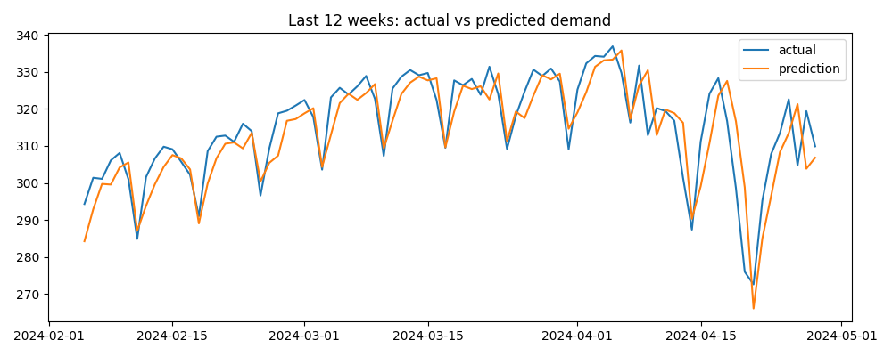

# Karnataka Electricity Demand Forecast

Predicting the daily electricity demand of Karnataka using Python and SQL.

## Questions
- How has electricity demand changed over the years?
- Which months use the most electricity?
- Can a simple model predict tomorrow's demand better than just using today's value?

## Data
- Daily electricity demand of Karnataka from 2013 to April 2024, in MU (million units). This comes from Grid-India's daily reports. I used a public CSV of these reports from [this GitHub repository](https://github.com/tanshah0509-dotcom/India-Electricity-Demand-Forecasting).
- Daily maximum temperature of Bengaluru from [Open-Meteo](https://open-meteo.com/).

## What I did
1. Cleaned the data with pandas and joined demand with temperature.
2. Used SQL to find yearly, monthly and weekday patterns.
3. Built a linear regression model using yesterday's demand, last week's demand, temperature, and whether the day is a Sunday or Monday.
4. Trained the model on older data and tested it on the last 12 weeks.
5. Compared the model with a simple guess (today = yesterday).

## Results
- Average daily demand grew from 165 MU in 2014 to 251 MU in 2023.
- Demand is highest from February to April and lowest in July.
- Sunday has the lowest demand.
- Model error is 1.79%, compared with 2.70% for the simple guess.

## Limitations
- I used the actual temperature of each day. In real life only a weather forecast would be available.
- Bengaluru temperature is used for the whole state.

## Files
- `power_demand_forecast.ipynb`: the full analysis
- `daily_energy_met_MU.csv`: electricity demand data
- `bengaluru_weather.csv`: temperature data
